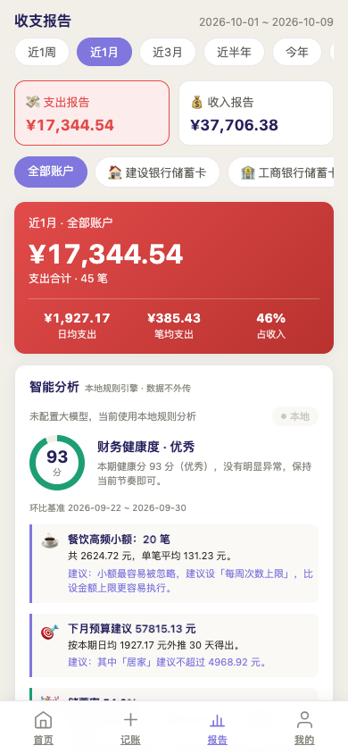
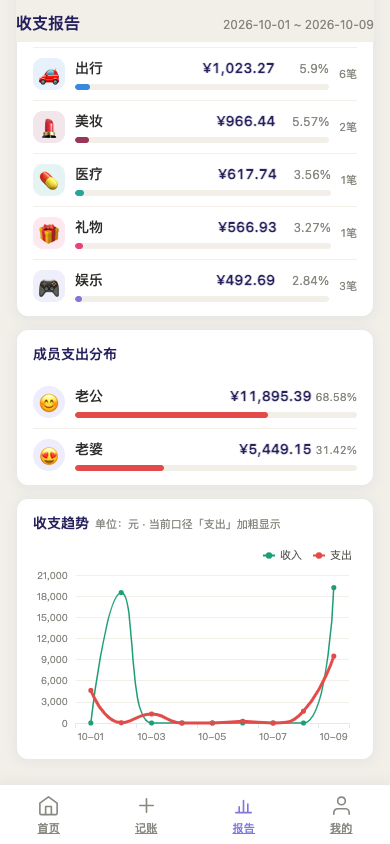
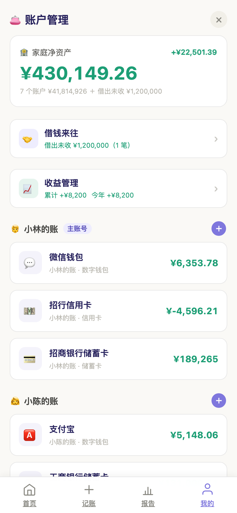
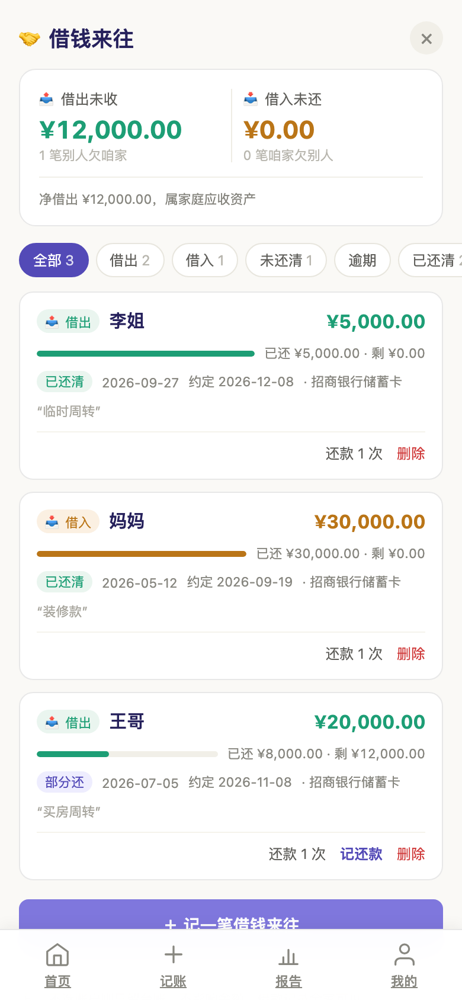
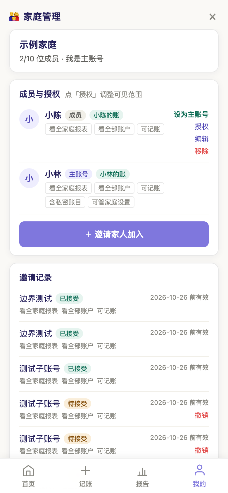
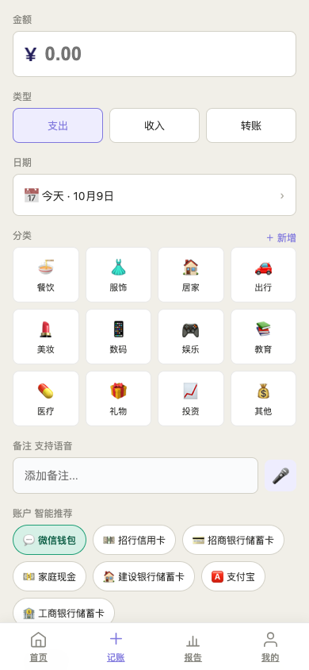
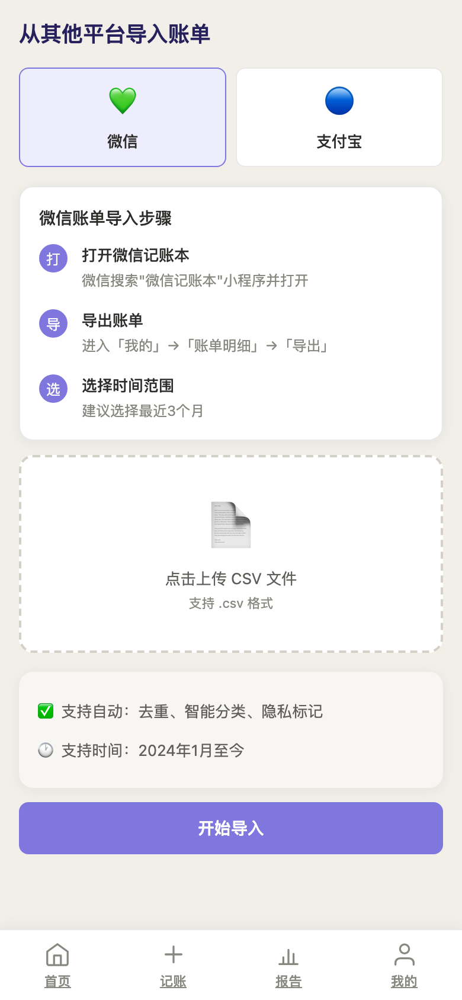
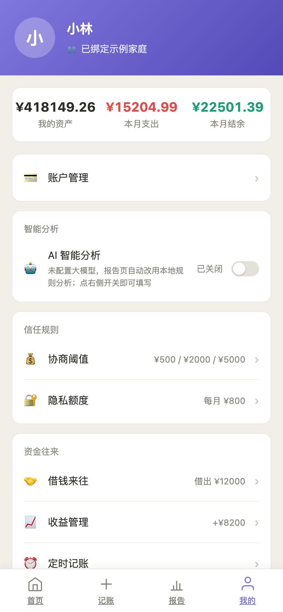

# 钱来钱往记账 · Family Ledger

> 给需要一起记账的家庭账本。个人账与共同账分开记，总额一起看；该公开的公开，该留隐私的留隐私。账本名由家庭自己定，不预设任何成员关系。

[](https://vuejs.org/)
[](https://www.djangoproject.com/)
[](./LICENSE)

一个**自托管**的家庭财务管理系统：双人协作记账、微信 / 支付宝账单一键导入、借钱来往台账、资产净值曲线、月度报告与 AI 智能分析。数据完全存在你自己的服务器上。

---

## 先看效果

| 首页 · 净资产 | 报告 · 智能分析 | 报告 · 分类与趋势 |
| :---: | :---: | :---: |
|  |  |  |

| 账户 · 三本账 | 借钱来往 | 家庭权限与阈值 |
| :---: | :---: | :---: |
|  |  |  |

| 记一笔 | 账单导入 | 我的 · 隐私额度与 AI |
| :---: | :---: | :---: |
|  |  |  |

---

## 为什么不一样

市面上的记账 App 大多是"单人账本 + 共享账号"，两个人用起来别扭。这个项目的出发点很具体：

- **三本账，互不污染** —— 账本一、账本二、共同账本独立记账、独立看余额（账本名可自定），同时自动汇总家庭净资产。
- **隐私有分寸** —— 每条流水可标记「私密消费」或「对配偶隐藏详情」；账户分「共同 / 对方可见 / 仅本人可见」。给对方看总额，不必把每一笔都摊开。
- **超额自动公开** —— 私密消费达到家庭设定的额度，自动转为公开，避免"偷偷攒大件"变成吵架导火索。
- **导入优先于手记** —— 微信、支付宝账单 CSV/压缩包拖进去，自动解析、自动去重、先预览再入库，不用一笔笔敲。
- **借钱来往单独成账** —— 借出、借入、部分还款、约定还款日，自动生成流水但**绝不计入收支统计**，不会把"还钱"错记成"消费"。
- **AI 分析可开可关** —— 配了 Key 就用大模型写财务点评，没配就用内置规则引擎，功能不打折。支持 DeepSeek / 通义 / Moonshot / 本地 Ollama 等 OpenAI 协议服务。

---

## 功能清单

| 模块 | 能力 |
| --- | --- |
| 家庭协作 | 手机号注册、家庭创建、成员邀请与管理、权限分级 |
| 记账 | 支出 / 收入 / 转账、17 个预设分类、商户与备注、日期时间、编辑与删除 |
| 隐私 | 私密消费、对配偶隐藏详情、家庭额度阈值、超额自动公开 |
| 账单导入 | 微信账单、支付宝账单、自动解析与指纹去重、导入前预览确认 |
| 账户资产 | 储蓄卡 / 信用卡 / 现金 / 数字钱包、余额手动调整（含审计说明）、计入总资产开关 |
| 资产快照 | 每月余额快照、月变化对比、资产净值曲线 |
| 借钱来往 | 借出 / 借入、部分还款、约定还款日、台账状态（未还 / 部分还 / 已还清） |
| 报告分析 | 月度收支、分类占比、趋势对比、结余与储蓄率 |
| AI 智能分析 | 界面内配置服务商与 Key，即时生效，带缓存，无需重启 |
| 微信小程序 | `miniprogram/` 提供首页 / 记账 / 导入 / 报告 / 我的 五个页面（骨架） |

金额全部以**分（整数）**存储，杜绝浮点误差。

---

## 技术栈

**后端** Django 6.0 · Django REST Framework · SimpleJWT · django-filter · drf-spectacular · django-cors-headers · Django-Q2 · Redis · PyMySQL · Pillow · httpx

**前端** Vue 3 · Vite · Vue Router · Pinia · Axios · ECharts · Day.js

**数据** MySQL 8（生产）/ SQLite（开箱即用）· Redis（缓存与队列）

---

## 快速开始

### 环境要求

| 依赖 | 版本 | 说明 |
| --- | --- | --- |
| Python | **3.12+** | Django 6.0 硬性要求 |
| Node.js | **20.19+ 或 22.12+** | Vite 7 的要求 |
| Redis | 可选 | 缓存、限流、异步队列 |
| MySQL | 可选 | 不配就用 SQLite，零配置启动 |

### 1. 拉取代码

```bash
git clone https://github.com/linapursue77/family-ledger.git
cd family-ledger
```

### 2. 启动后端

```bash
cd backend

# 创建虚拟环境
python -m venv .venv
source .venv/bin/activate            # Windows: .venv\Scripts\activate

# 安装依赖
pip install -r requirements.txt

# 配置文件
cp .env.example .env                 # Windows: copy .env.example .env

# 建表 + 初始化分类
python manage.py migrate
python manage.py seed_categories

# 启动（默认 http://127.0.0.1:8001）
python manage.py runserver 127.0.0.1:8001
```

> **开箱即用**：`.env` 里的 `DB_HOST` 保持为空即使用 SQLite，无需装 MySQL。
> 想用 MySQL：填好 `DB_HOST` / `DB_USER` / `DB_PASSWORD`，并手动创建 `DB_NAME` 对应的空数据库（UTF-8）。

### 3. 启动前端

```bash
cd frontend
npm install
npm run dev                          # http://127.0.0.1:5173
```

Vite 已配置 `/api` 代理到 `127.0.0.1:8001`，无需额外配置跨域。

### 4. 登录

打开 `http://127.0.0.1:5173`，使用演示账号登录：

| 账号 | 密码 | 角色 |
| --- | --- | --- |
| `13800138000` | `test123456` | 小林（主账号） |
| `13800138001` | `test123456` | 小陈（子账号） |

想复现 README 截图里的效果，一条命令造出完整演示数据（7 个账户、6 个月 300+ 笔流水、借钱台账、资产快照）：

```bash
cd backend
python manage.py seed_showcase          # 加 --reset 可清空重建
```

### 其他常用命令

```bash
python manage.py createsuperuser          # 后台管理员 /admin/
python manage.py qcluster                 # 异步任务（账单解析、每日快照）
python manage.py setup_schedules          # 注册定时任务
python manage.py snapshot_accounts        # 手动生成资产快照
python manage.py seed_all                 # 组合种子数据
python scripts/smoke.py                   # 接口冒烟测试
```

API 文档：`http://127.0.0.1:8001/api/docs/`（Swagger）

---

## 单端口运行（推荐给非开发者）

不想同时跑两个服务？项目已内置构建产物 `frontend/dist`，后端可直接托管：

```bash
cd frontend && npm run build && cd ../backend
python manage.py collectstatic --noinput

# 替换最后一行命令为：
SERVE_WEB=True python manage.py runserver 0.0.0.0:8001
```

然后访问 `http://<你的IP>:8001`，手机连同一 WiFi 也能直接用。把它加到桌面就是个 App。

---

## 目录结构

```
family-ledger/
├── backend/                 # Django 后端
│   ├── apps/
│   │   ├── core/            # 健康检查、统一响应、静态托管
│   │   ├── users/           # 用户与认证（JWT）
│   │   ├── families/        # 家庭、成员、权限
│   │   ├── accounts/        # 账户与资产快照
│   │   ├── ledger/          # 记账、分类、导入、报告
│   │   └── loans/           # 借钱来往
│   ├── config/              # settings / urls / wsgi / middleware
│   ├── domain/              # 领域层
│   ├── scripts/             # 冒烟测试脚本
│   ├── manage.py
│   └── requirements.txt
├── frontend/                # Vue 3 + Vite 前端
│   ├── src/
│   │   ├── api/             # 接口封装
│   │   ├── components/      # 可复用组件
│   │   ├── router/          # 路由与登录守卫
│   │   ├── stores/          # Pinia 状态
│   │   ├── utils/           # 金额格式化等工具
│   │   └── views/           # 页面
│   └── dist/                # 构建产物（单端口模式直接可用）
├── miniprogram/             # 微信小程序
├── deploy/                  # 部署脚本与配置
└── DEPLOY.md                # 服务器部署文档
```

---

## 部署到服务器

完整方案（Docker Compose、Nginx、systemd、自动备份、一键更新脚本）见 **[DEPLOY.md](./DEPLOY.md)**，内含：

- `deploy/install.sh` 一键安装
- `deploy/update.sh` 增量更新（只重建变化的部分）
- `deploy/backup.sh` 数据库定时备份
- `deploy/docker-compose.yml` 容器化部署

生产环境务必修改 `.env` 中的 `SECRET_KEY`，并将 `DEBUG` 设为 `False`。

---

## 常见问题

**Q：不装 MySQL 和 Redis 能跑吗？**
能。`DB_HOST` 留空自动使用 SQLite；Redis 仅用于缓存与异步队列，缺失时系统自动降级，核心记账功能不受影响（账单导入与定时快照会退化为同步执行）。

**Q：Vite 启动报 `esbuild` 二进制错误？**
macOS 11 及更早版本的机器不支持 Vite 7 依赖的 esbuild 0.25。两种解法：升级到 macOS 12+，或把前端工具链降级：

```bash
npm install -D vite@^5 @vitejs/plugin-vue@^5
```

**Q：后端起来但前端请求 401？**
先确认 `/api/v1/core/health/` 是否返回 `{"status":"ok"}`；再检查前端是否通过 `5173` 端口访问（代理生效），直接访问 `8001` 会因跨域失败。

**Q：账单导入支持哪些格式？**
微信和支付宝导出的 CSV / zip 账单文件，系统自动识别编码（含 GBK）与表头，导入前可逐条预览勾选。

---

## 参与贡献

欢迎 Issue 与 PR。提交前请确保：

```bash
cd backend && python scripts/smoke.py     # 后端接口冒烟
cd frontend && npm run build              # 前端构建通过
```

---

## License

[MIT](./LICENSE) — 自用、修改、二次分发均可，记得保留署名。

如果这个项目对你有用，点个 ⭐ 就是最大的支持。
